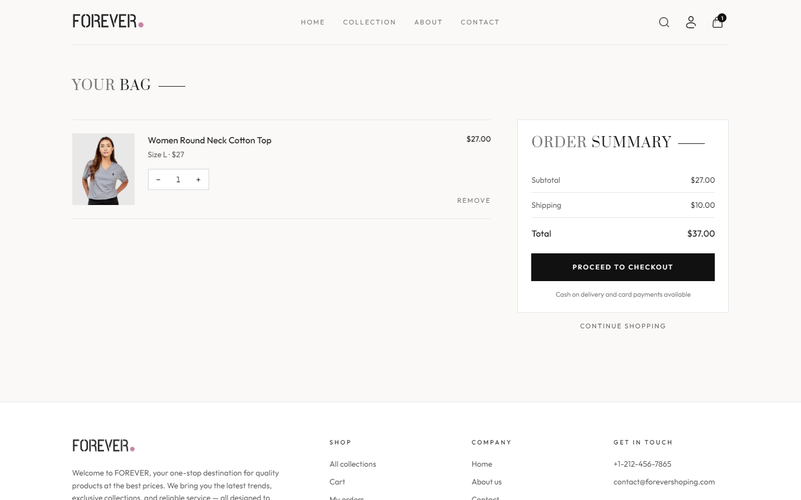
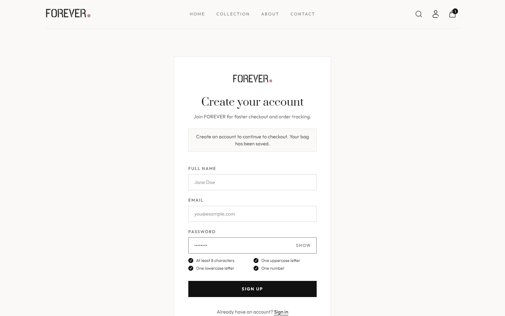
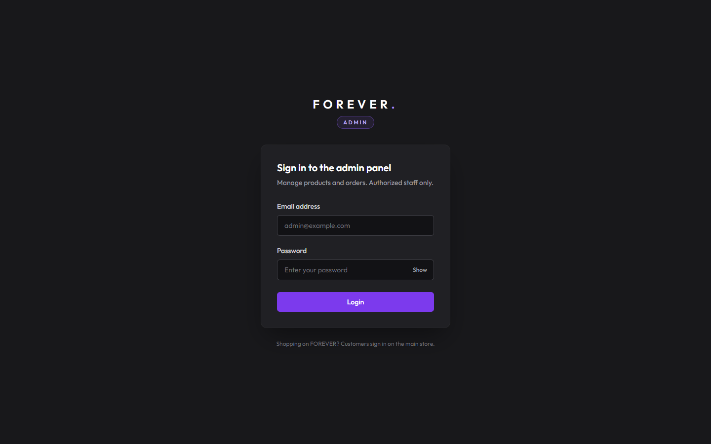

# FOREVER — MERN Fashion E-commerce

A full-stack fashion store with an editorial customer storefront, a separate admin panel, and an
Express/MongoDB API. Customers can browse, filter and add to their bag without an account, check out
with cash on delivery or Stripe, and manage their profile and orders. Admins manage products and
order fulfilment from a dark, purple-accented dashboard.


## Features

**Storefront** (`frontend/`)
- Editorial homepage: layered hero with subtle parallax, shop-by-category tiles built from live
  catalogue data, latest arrivals, best sellers, brand story band.
- Collection page with category/type filters, sorting and search — all kept in the URL, with result
  counts, removable filter chips, empty states and a mobile filter drawer.
- Product pages with image gallery and hover zoom, accessible size picker, related products.
- Guest bag stored locally and merged into the account bag on sign-in; login is only required at
  checkout, and the customer is returned to checkout afterwards.
- Checkout with cash on delivery or Stripe (card), duplicate-submit protection, and a confirmation
  page that only shows success once the backend has the order (and, for Stripe, has verified payment).
- My Account: profile name, password change (with live strength checklist), order history with a
  status timeline, and cancellation of unpaid orders that haven't shipped.
- Loading skeletons, actionable error states, consistent toasts, keyboard-visible focus, reduced-motion
  support, responsive from 360px to wide desktop.

**Admin panel** (`admin/`)
- Separate FOREVER ADMIN identity (charcoal + violet).
- Dashboard with live counts (products, orders, awaiting fulfilment, paid revenue) and recent orders.
- Add products with up to four images (Cloudinary), sizes, category and bestseller flag — validated
  before upload.
- Product list with confirm-before-delete; order management with status updates (including Cancelled).

**API** (`backend/`)
- Express 5 + Mongoose, JWT auth, Cloudinary uploads, Stripe Checkout.

| Collection | Product | Bag |
|---|---|---|
|  |  |  |

| Sign up | Admin login | Admin products |
|---|---|---|
|  |  |  |


## Tech stack

| Layer | Technology |
|---|---|
| Storefront & admin | React 19, React Router 7, Vite 7, Tailwind CSS 3, Axios, React-Toastify |
| API | Node.js, Express 5, Mongoose 8 (MongoDB Atlas), JSON Web Tokens, bcrypt, Multer |
| Services | Cloudinary (product images, on-the-fly resizing), Stripe Checkout |

## Project structure

```
backend/    Express API — routes/, controllers/, models/, middleware/ (auth, adminAuth, multer)
frontend/   Customer storefront (Vite + React)
admin/      Admin panel (Vite + React)
docs/       README screenshots
```

## Getting started

Requirements: Node.js 20+ and npm, a MongoDB database, a Cloudinary account, and a Stripe test key.

```bash
# 1. API
cd backend
cp .env.example .env        # fill in your values
npm install
npm run server              # http://localhost:4000 (nodemon) — or: npm start

# 2. Storefront
cd ../frontend
cp .env.example .env
npm install
npm run dev                 # http://localhost:5173

# 3. Admin panel
cd ../admin
cp .env.example .env
npm install
npm run dev -- --port 5174  # http://localhost:5174
```

Sign in to the admin panel with the `ADMIN_EMAIL` / `ADMIN_PASSWORD` from `backend/.env`.
For Stripe, use test card `4242 4242 4242 4242`, any future expiry and any CVC; set `FRONTEND_URL`
to the storefront URL so Stripe returns to it.

Checks:

```bash
npm run lint    # in frontend/ or admin/
npm run build   # in frontend/ or admin/
```

## Environment variables

| App | Variable | Purpose |
|---|---|---|
| backend | `MONGODB_URI` | MongoDB connection string (database `e-commerce` is appended) |
| backend | `JWT_SECRET` | Signs customer and admin tokens |
| backend | `ADMIN_EMAIL`, `ADMIN_PASSWORD` | Admin panel credentials |
| backend | `CLOUDINARY_NAME`, `CLOUDINARY_API_KEY`, `CLOUDINARY_SECRET_KEY` | Product image uploads |
| backend | `STRIPE_SECRET_KEY` | Stripe Checkout |
| backend | `FRONTEND_URL` | Storefront URL used for Stripe redirects |
| backend | `BACKEND_URL` | Public API URL for Stripe return URLs (required in production; defaults to `http://localhost:<PORT>` in development) |
| frontend, admin | `VITE_BACKEND_URL` | API base URL |

## Security notes

- Order prices and totals are calculated on the server from the database; client-sent prices are ignored.
- Stripe payments are confirmed by retrieving the order's stored Checkout Session from Stripe — the
  redirect URL alone can't mark an order as paid. Cancelled checkouts expire the session and remove the
  unpaid order; abandoned sessions expire after 30 minutes and are cleaned up when orders are listed.
- Stripe return URLs are built from the configured `BACKEND_URL`, not the request's Host header.
- Delivery addresses are validated on the server with the same rules as the checkout form.
- Paid orders can't be marked Cancelled by an admin (no refund workflow exists). Cash-on-delivery
  orders are marked paid when set to Delivered.
- Admin routes require a signed, expiring token with an `admin` role; customer tokens are rejected.
  Admin tokens never contain the password.
- Customer endpoints identify the user from the token only, so customers can access only their own
  profile and orders. Customers can cancel only their own unpaid orders before they ship.
- Customer tokens expire after 7 days; both apps sign out cleanly when a session expires.

## API overview

| Method | Path | Auth | Description |
|---|---|---|---|
| POST | `/api/user/register`, `/api/user/login` | — | Customer sign-up / sign-in |
| POST | `/api/user/admin` | — | Admin sign-in |
| POST | `/api/user/profile`, `/api/user/profile/update`, `/api/user/password` | customer | Account |
| GET | `/api/product/list` · POST `/api/product/single` | — | Catalogue |
| POST | `/api/product/add`, `/api/product/remove` | admin | Manage products |
| POST | `/api/cart/get`, `/api/cart/add`, `/api/cart/update` | customer | Bag |
| POST | `/api/order/place`, `/api/order/stripe` | customer | Place order (COD / Stripe) |
| GET | `/api/order/verifyStripe` | Stripe redirect | Verify Stripe payment |
| POST | `/api/order/userorders`, `/api/order/cancel` | customer | Order history / cancel |
| POST | `/api/order/list`, `/api/order/status` | admin | All orders / update status |

## Known limitations

- No password-reset email flow, saved addresses, or product reviews (not implemented in the API, so
  not shown in the UI).
- Paid card orders can't be cancelled online or by admins (refunds aren't implemented); customers are
  asked to contact support and refunds are issued from the Stripe dashboard.
- No Stripe webhook: payment state is reconciled when the customer returns from Stripe or when order
  lists are loaded, rather than pushed by Stripe.
- No rate limiting on the login endpoints yet.
