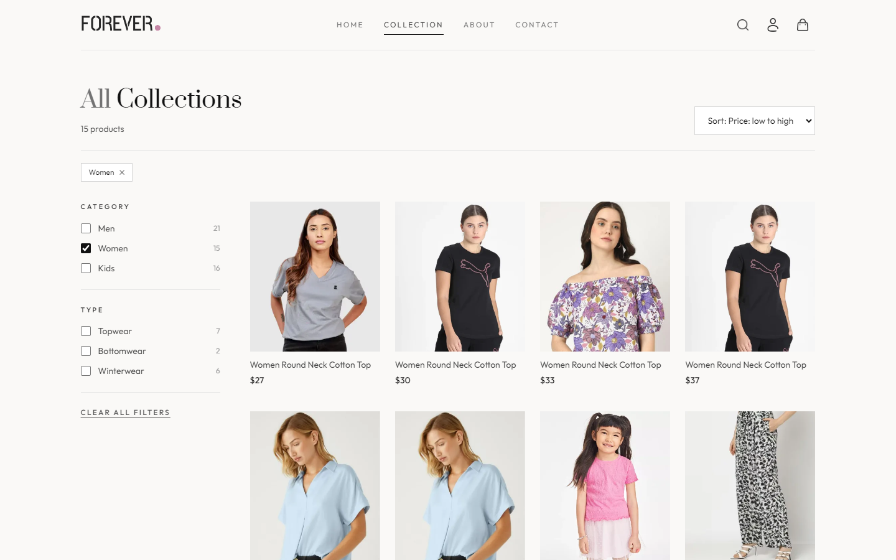
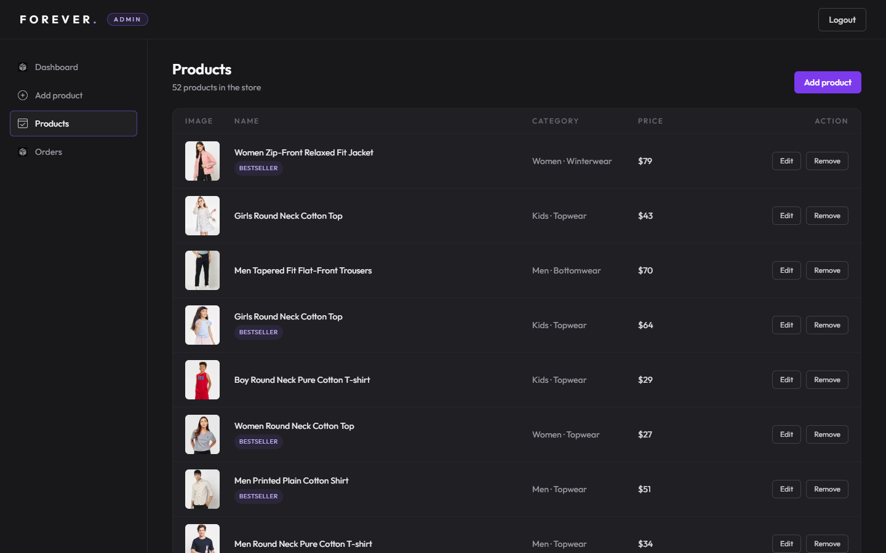

# FOREVER — MERN Fashion E-commerce

A full-stack fashion store built with MongoDB, Express, React and Node.js: an editorial customer
storefront, a separate admin panel, and a REST API with Stripe payments and Cloudinary image hosting.

## Features

**Storefront** (`frontend/`)
- Editorial homepage, collection page with URL-based filters, sorting and search, and product pages with an image gallery
- Guest shopping bag that persists across refreshes and merges into the account bag on sign-in
- Checkout with cash on delivery or Stripe card payments, with client- and server-side validation
- Account area: profile, password change, order history with status tracking, and cancellation of unpaid orders
- Responsive, keyboard-accessible UI with loading, empty and error states

**Admin panel** (`admin/`)
- Dashboard with live product, order and revenue figures
- Add and edit products with up to four images, sizes, category and bestseller flag
- Order management with status updates

**Backend API** (`backend/`)
- Express 5 REST API with Mongoose models for users, products and orders
- JWT authentication with separate customer and admin roles
- Stripe Checkout integration and Cloudinary image uploads

## Screenshots

| Collection | Product | Admin products |
|---|---|---|
|  |  |  |

## Tech stack

- **Frontend & admin:** React 19, React Router 7, Vite 7, Tailwind CSS 3, Axios
- **Backend:** Node.js, Express 5, MongoDB with Mongoose 8, JWT, bcrypt, Multer
- **Services:** Stripe Checkout, Cloudinary

## Environment variables

Templates are provided in each app's `.env.example`. Never commit real `.env` files.

- **backend:** `MONGODB_URI`, `JWT_SECRET`, `ADMIN_EMAIL`, `ADMIN_PASSWORD`, `CLOUDINARY_NAME`,
  `CLOUDINARY_API_KEY`, `CLOUDINARY_SECRET_KEY`, `STRIPE_SECRET_KEY`, `FRONTEND_URL`, `BACKEND_URL`
- **frontend, admin:** `VITE_BACKEND_URL`

## Security highlights

- Prices, totals and delivery addresses are validated on the server; client-sent prices are ignored.
- Stripe payments are verified with Stripe before an order is marked paid.
- Role-based, expiring JWTs: customers can access only their own data, and admin routes reject customer tokens.

## Known limitations

- No password reset by email, saved addresses or product reviews.
- Refunds aren't automated: paid card orders can't be cancelled in the app and are refunded via the Stripe dashboard.
- No Stripe webhook; payment status is reconciled when customers return from Stripe or when order lists load.
